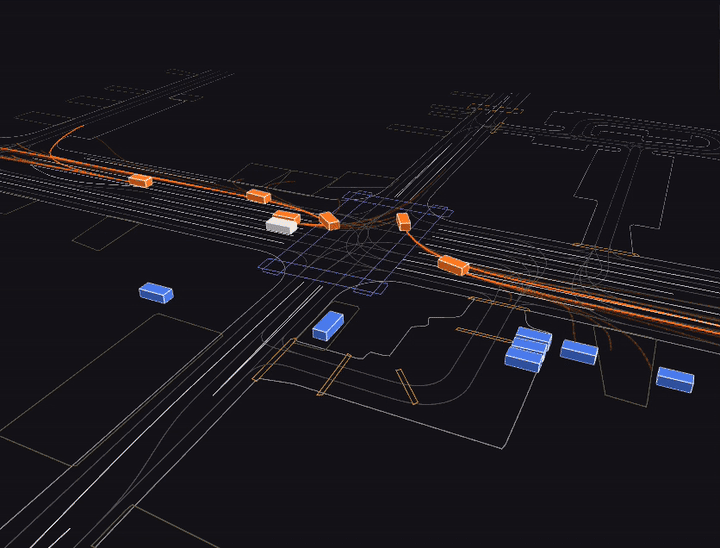
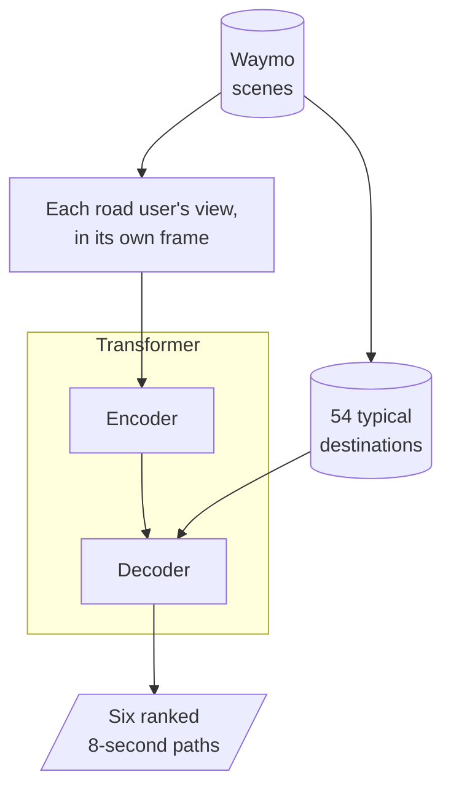

# MotionNet

Motion prediction for the Waymo Open Motion Dataset, in Python and PyTorch. From one second of
a road user's history, the traffic around it, the lane geometry and the traffic-light states,
it predicts six possible paths for the next eight seconds, each with a confidence. A car
approaching a junction may turn or continue straight, and a single prediction would average
the two.



*Orange boxes are the road users being predicted. The orange lines in front of each one are
its predicted paths, and the magenta line is the path it actually took. The white box is the
Waymo car.*

## Results

minADE is the mean distance, in metres, between the recorded path and the closest of the six
predictions. Lower is better.

| minADE (m)                | 3 s  | 5 s  | 8 s   |
|---------------------------|------|------|-------|
| cars, validation          | 0.35 | 0.74 | 1.44  |
| cars, test                | 0.35 | 0.74 | 1.43  |
| cars, control             | 2.33 | 5.47 | 10.98 |
| pedestrians, validation   | 0.19 | 0.37 | 0.65  |
| pedestrians, test         | 0.19 | 0.37 | 0.65  |
| pedestrians, control      | 0.47 | 0.89 | 1.55  |
| cyclists, validation      | 0.38 | 0.71 | 1.26  |
| cyclists, test            | 0.37 | 0.71 | 1.28  |
| cyclists, control         | 1.14 | 2.26 | 4.17  |

Soft mAP, the metric Waymo ranks this challenge by, averaged over every object type and
horizon: 0.357 on validation, 0.353 on test.

Validation (44,097 scenes) and test (44,920 scenes) were graded by Waymo's evaluation server.
The control assumes constant speed and heading, scored with Waymo's metric code on the
validation scenes. The model has 12M parameters and was trained for 20 epochs on 122,352
scenes, a quarter of the training split.

## Method

1. Before training, the endpoints of the training paths are clustered with k-means into 54
   typical destinations per object type: straight and far, gentle left, hard right. These are
   the anchors.
2. Each road user being predicted is seen in its own frame, with its history, the 48 other
   agents and 256 map chunks nearest the straight path it would cover in 8 s, and the
   traffic-light states.
3. A 6-layer transformer encoder reads the scene. A 6-round transformer decoder starts one
   query from each anchor and adjusts that anchor's path, and a second head scores how likely
   each anchor is.
4. Training uses a Gaussian likelihood on one anchor's path plus cross-entropy on the
   confidences. The anchor trained is the one whose constant-speed straight path lies closest
   to the recorded path.
5. At prediction time the 54 paths are ranked by confidence, near-duplicates are dropped, and
   the top six are kept. The whole model also exports to one ONNX graph, checked against
   PyTorch.



## Build and run

Needs Python 3 and the pinned packages in `requirements.txt`. Waymo's own metrics package has
no macOS build, so scoring runs in Docker. The input is the Waymo Open Motion Dataset's
scenario TFRecords, which need a Waymo account. No trained model is included: stage the
data, fit the anchors and train before predicting.

```
make install    # pinned dependencies
make test       # test suite; tests that need staged scenes skip without them
make stage      # raw scenario shards to one .npz per scene
make anchors    # fit the 54 anchors on the staged training scenes
make train      # train, resuming from the checkpoint if one exists
make predict    # predictions for the staged scenes
make score      # Waymo's metrics on a slice of staged scenes, in Docker
make export     # export to ONNX, check it against PyTorch, time both
make live       # play staged scenes with live predictions on ws://127.0.0.1:8765
```

Paths default to folders under `data/`. Set `SHARDS`, `STAGED`, `STAGED_TRAINING`, `ANCHORS`
or `CHECKPOINT` on the `make` command line, and run `make help` for the rest.

To watch, open Lichtblick, import `lichtblick_layout.json` from the Layouts tab, run
`make live`, then choose Open connection, Foxglove WebSocket and `ws://127.0.0.1:8765`.

## Known limitations

- One training run, so run-to-run spread hasn't been measured.
- `make score` handles a slice of scenes. On the full split its ground truth doesn't fit in
  memory, so the numbers above come from Waymo's evaluation server.
